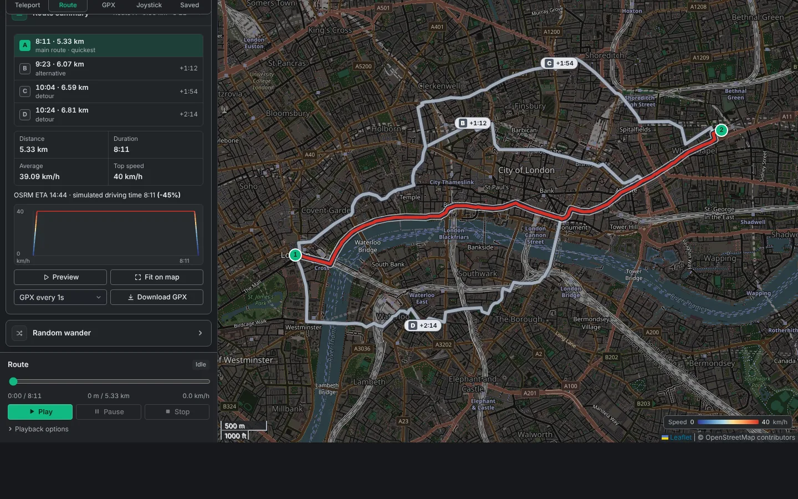
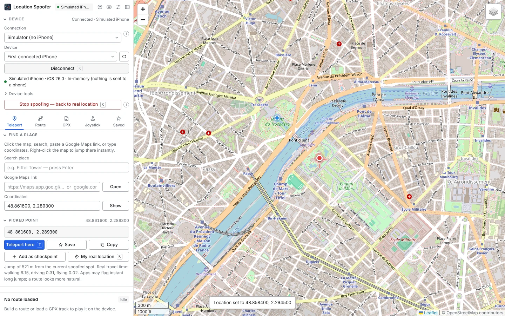
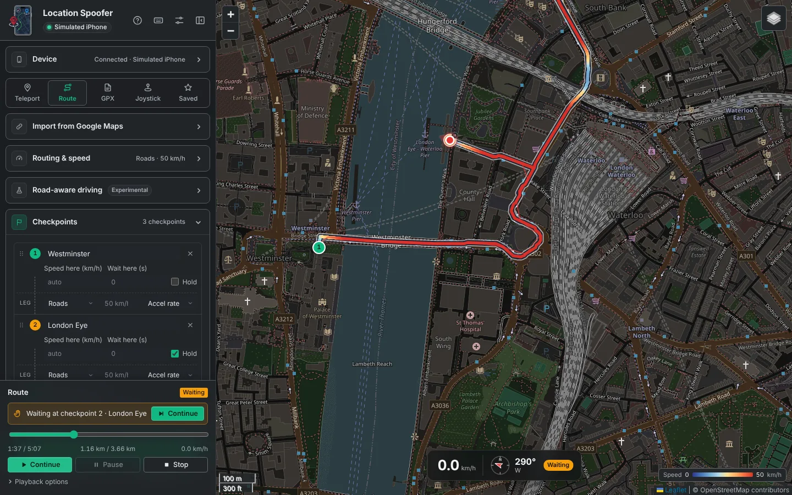
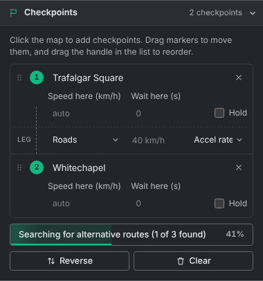
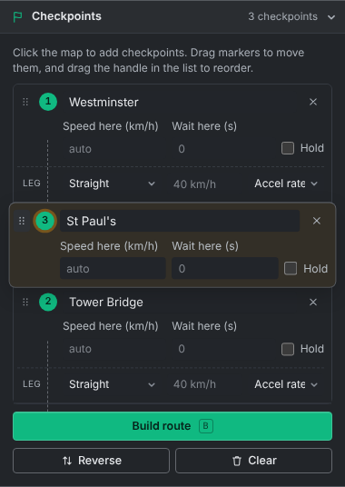
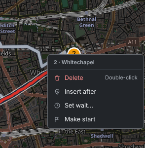
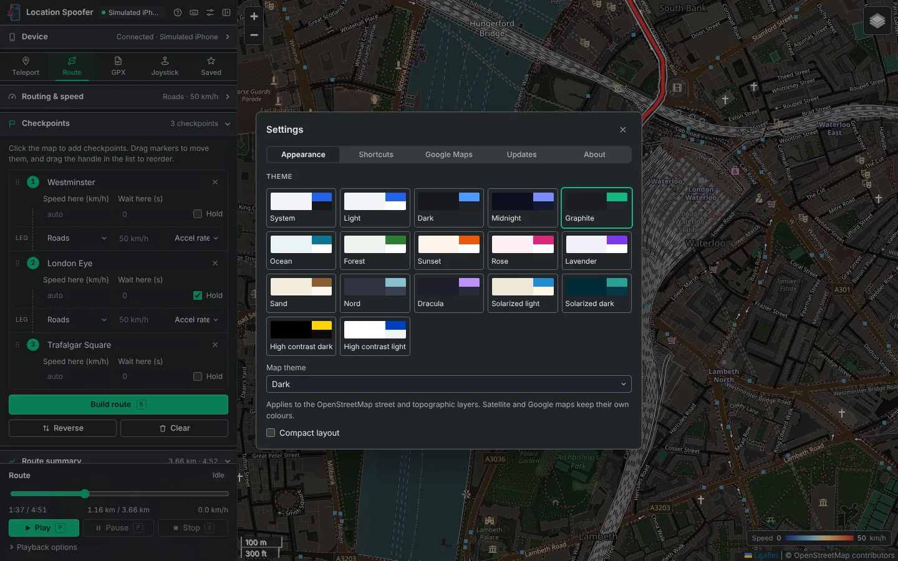

<p align="center"></p>

<h1 align="center">Location Spoofer</h1>

<p align="center">Set your iPhone's GPS location from your Windows PC over a USB cable.<br>
Jump anywhere, follow real roads at realistic speeds, replay GPX files, or walk around live with the keyboard.</p>

<p align="center">
  <a href="https://github.com/YK3D/iPhone-location-spoofer/releases?q=standalone&expanded=true"><b>⬇ Download the app (Standalone)</b></a> ·
  <a href="https://github.com/YK3D/iPhone-location-spoofer/releases?q=browser&expanded=true">Browser edition</a> ·
  <a href="#getting-started">Getting started</a> ·
  <a href="PRIVACY.md">Privacy</a> ·
  <a href="TERMS.md">Terms</a>
</p>

<p align="center"></p>

> **Use it responsibly.** Location simulation is meant for testing your own apps, demos and privacy. Many games, dating, banking, school, work and delivery apps forbid fake locations and may suspend your account. Apps can also detect simulation or use Wi-Fi, IP address and motion sensors, which this tool does not change. See the [Terms of Use](TERMS.md).

## Screenshots

| | |
|---|---|
|  |  |
| **Teleport:** pick a point, see the jump distance, teleport. | **Playback:** waiting at a "hold until Continue" checkpoint; the map shows live speed and heading. |
|  |  |
| **Building a route:** the button shows each step and how far along it is. | **Reordering:** drag a checkpoint by its handle; the others slide out of the way. |
|  | |
| **Checkpoint menu:** right-click a checkpoint on the map or in the list. | |

<p align="center"></p>

The screenshots are made by [`docs/screenshots/capture.js`](docs/screenshots/capture.js) with the default look (Graphite theme, dark map).

## Which edition should I use?

| | **Standalone app** (recommended) | Browser edition |
|---|---|---|
| Download | [`LocationSpooferStandalone.exe`](https://github.com/YK3D/iPhone-location-spoofer/releases?q=standalone&expanded=true) | [`LocationSpooferBrowser.exe`](https://github.com/YK3D/iPhone-location-spoofer/releases?q=browser&expanded=true) |
| Window | Its own app window | Opens in your web browser, plus a console window |
| Size and start-up | Under 20 MB, starts instantly | About 80 MB, 10–20 s to start |
| iOS 17.4 and newer, iOS 16 and older | ✅ | ✅ |
| iOS 17.0–17.3 | ❌ | ✅ (with the administrator "tunnel helper") |
| Fallback connection using pymobiledevice3 commands | — | ✅ |
| Written in | Rust | Python |

Both editions have the same interface and features. They update themselves from their own release pages.

## Features

* **Map:** streets, satellite and topographic views. Click to pick a point; right-click to jump there instantly.
* **Find places:** search by name, paste coordinates (decimal or 40°42'46"N), or paste any **Google Maps link**, including `maps.app.goo.gl` short links and directions links with several stops.
* **Routes:**
  * add checkpoints on the map, then drag them on the map or in the list to move and reorder them;
  * drag the route line to add a checkpoint there (the route rebuilds itself), double-click a checkpoint to delete it, or right-click it for **Delete**, **Insert after**, **Set wait** and **Make start**;
  * a checkpoint can **hold until you press Continue** (or **N**), for example to wait at a door until your test is ready;
  * each leg follows roads, cycle paths, footpaths, sea lanes or a straight line, routed by OpenStreetMap or by Google with your own API key;
  * set a speed per leg, an exact speed at chosen checkpoints, and wait times;
  * acceleration and braking change speed smoothly;
  * ask for up to three alternative routes, labelled on the map with their extra time, and pick one in the list or on the map;
  * the Build route button shows each step as it happens (routing each leg, speed limits, turns, ETA) and how far along it is;
  * the route line is outlined so it stands out from the roads, and coloured by speed in a smooth gradient, with a speed chart;
  * hover a checkpoint in the list to highlight it on the map.
* **Road-aware driving (experimental):**
  * follows each road's typical speed, and optionally public speed limits (not recommended: the public service is slow and often incomplete);
  * slows for bends, roundabouts and U-turns, and on private or gated roads;
  * aims for the same trip time (ETA) as Google Maps or OpenStreetMap, shown side by side.
* **GPX files:** drop a file in to replay it with its own timing, re-time it, reverse it, or edit it as checkpoints. Routes can be exported as GPX.
* **Playback:** play, pause, seek, 0.25×–30× speed, loop or back-and-forth with an optional number of laps, optional GPS jitter, and a live speed and heading display on the map.
* **Joystick:** walk or drive live with W A S D, the arrow keys or the on-screen pad.
* **Stop spoofing:** one click returns the iPhone to its real GPS and shows your computer's real location on the map.
* **Made to be comfortable:**
  * 17 colour themes (Graphite by default) and a dark or light map;
  * folding sections, and a side menu you can resize or hide;
  * single-key keyboard shortcuts that you can change (press **H** to see them);
  * a setup guide on first run, and **(i)** buttons that explain every tool;
  * favourites, saved routes, and backup or restore.

## Getting started

1. **Install Apple's iPhone software.** Get **Apple Devices** from the Microsoft Store (iTunes also works). It provides the driver and background service Windows needs to talk to an iPhone. You don't need to keep its window open.
2. **Download** the [standalone app](https://github.com/YK3D/iPhone-location-spoofer/releases?q=standalone&expanded=true). Save `LocationSpooferStandalone.exe` in a folder you own, such as Desktop or Documents, so it can update itself.
3. **Run it.** Windows may show "Windows protected your PC" because the app is not code-signed yet. Choose **More info → Run anyway**.
4. **Follow the setup guide** that opens on first run:
   1. Plug in the iPhone, unlock it and tap **Trust**.
   2. Press **Reveal Developer Mode**.
   3. On the iPhone, turn on *Settings › Privacy & Security › Developer Mode* and restart it.
   4. Press **Connect**.
5. **Pick a place and press Teleport here**, or build a route and press **Play**. Press **Stop spoofing** when you're done.

**Requirements:**
* Windows 10 or 11 (64-bit) with the Microsoft Edge WebView2 Runtime, which is built into Windows 11 and installed on up-to-date Windows 10.
* An iPhone or iPad with Developer Mode.
* A USB cable.
* An internet connection for maps and road routing.

### Troubleshooting

| Message | What to do |
|---|---|
| "Cannot reach the Apple device service" | Install the Apple Devices app (or iTunes), then reconnect the cable |
| "Tap Trust on the iPhone" | Unlock the phone, tap Trust and enter the passcode |
| "Developer Mode is off" | Device tools › Reveal Developer Mode, then turn it on in Settings on the iPhone |
| Location doesn't change in an app | Check Apple Maps first, then fully close and reopen the app |
| A speedometer app on the iPhone shows 0, or the heading arrow doesn't turn | Apple's location simulation only carries a position, so iOS reports no speed or course for it. Apps that work out speed from movement (navigation apps, most games) are fine. The app's own map shows the simulated speed and heading |
| "My real location" says Windows blocked it | Turn on *Settings › Privacy & security › Location* and "Let desktop apps access your location" (the message has a button for it) |
| Location stays wrong after you finish | Press **Stop spoofing**, or restart the iPhone |
| The app shows an older version number | An older copy is still running in the background. Close every Location Spoofer window, end any **location-spoofer** or **LocationSpooferStandalone** task in Task Manager, then open the new file. Version 0.2.4 and newer close older copies by themselves |

## Updates and test builds

The app checks for updates when it starts and every few hours. It downloads them in the background, verifies their SHA-256 checksum and installs them when you press **Restart now** or the next time you open the app.

In **⚙ Settings › Updates** you can switch to **Test builds**: pre-releases with the newest features from the `dev` branch, which may contain bugs.

## Optional: Google Maps

Routes can come from Google Maps if you add your own API key in **⚙ Settings › Google Maps**:

1. Create a project and an API key in the [Google Cloud console](https://console.cloud.google.com/).
2. Enable the **Routes API** and the **Map Tiles API**.
3. Restrict the key to those two APIs.

Google bills per request after its free monthly allowance. As Google's terms require, Google routes are shown on Google's map and cannot be exported as GPX. Without a key, routing uses free OpenStreetMap services, and Google Maps links still work.

## Privacy

The app has no accounts, no analytics and no telemetry. Your favourites, routes and settings stay on your computer. Maps, searches and routes are requested directly from the services listed in the [Privacy Policy](PRIVACY.md).

## Building from source

```bash
# Standalone app (Rust). Linux needs libwebkit2gtk-4.1-dev libgtk-3-dev libsoup-3.0-dev
cd standalone
cargo run --release              # app window
cargo run --release -- --no-window
cargo test

# Browser edition (Python 3.12)
cd browser
pip install -r requirements-dev.txt
python -m spoofer
python -m pytest
```

| Folder | Contents |
|---|---|
| `standalone/` | Rust app: local server, iPhone driver, routing, speed engine |
| `browser/` | Python edition |
| `ui/` | The shared interface (HTML, CSS, JavaScript) |
| `assets/` | Icon |
| `docs/` | Design notes |

## Licence

* The standalone app, the shared interface and the icon are released under the [MIT License](LICENSE).
* The browser edition is released under the [GNU GPL v3 or later](browser/LICENSE), because it ships with GPL-licensed libraries.
* Third-party components and services are listed in [THIRD_PARTY_NOTICES.md](THIRD_PARTY_NOTICES.md).
* Security issues: see [SECURITY.md](SECURITY.md).

Location Spoofer is an independent project and is not affiliated with, endorsed by or sponsored by Apple Inc. or Google LLC. iPhone is a trademark of Apple Inc.; Google Maps is a trademark of Google LLC.
